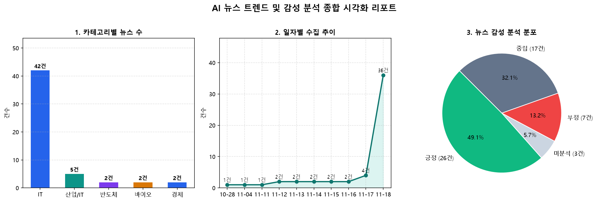
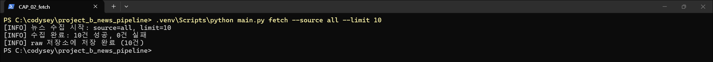
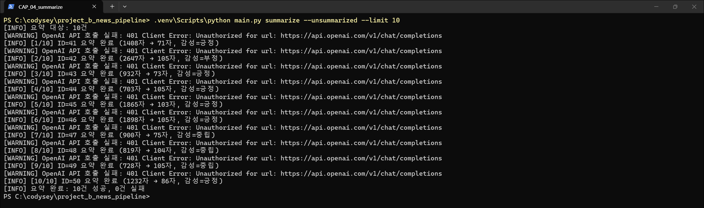
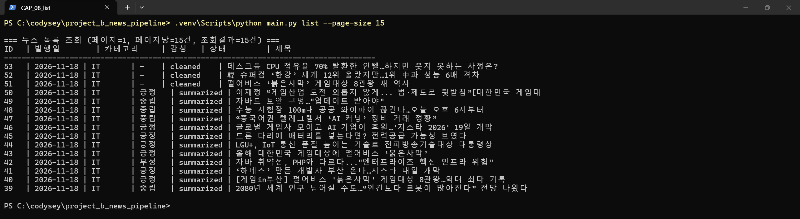
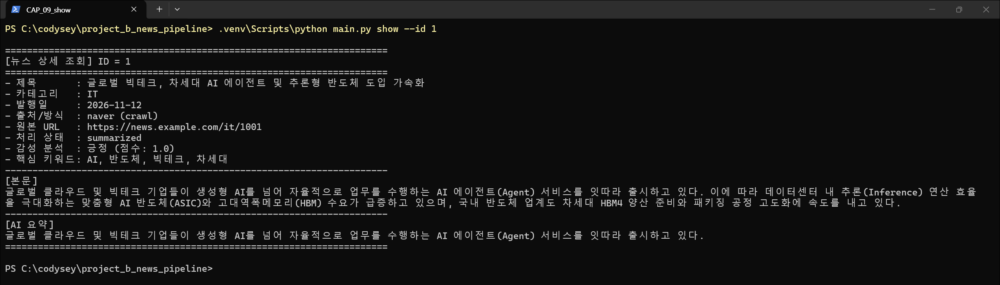

# [Project B] AI 뉴스 트렌드 및 종합 분석 리포트 CLI 서비스

외부 뉴스 데이터(RSS/API 및 웹 크롤링)를 자동 수집하여 **Raw/Clean 저장소에 분리 저장**하고, **AI API(Gemini)를 활용한 본문 요약·감성 분석·인사이트 도출**부터 **시각화 차트(PNG) 및 종합 리포트(MD/TXT/CSV/Excel) 생성**까지 수행하는 End-to-End 데이터 파이프라인 CLI 애플리케이션입니다.

## 1. 프로젝트 구조 및 모듈 설계 (7개 핵심 모듈 분리)

단일 파일이 아닌 역할별로 명확히 분리된 모듈 아키텍처로 구성되어 있습니다.

```text
project_b_news_pipeline/
├── main.py              # argparse 기반 서브커맨드 CLI 엔트리포인트 (필수 6종 + 보너스 3종)
├── config_loader.py     # config.json, .env 환경변수 로드 및 logging(INFO/WARNING/ERROR) 초기화
├── storage.py           # 영구 저장소 모듈 (SQLite DB + raw/clean JSONL 파일 동기화 관리)
├── fetcher.py           # 뉴스 수집 모듈 (RSS/XML 파싱 + BeautifulSoup 크롤링 + 타임아웃/딜레이 제어)
├── cleaner.py           # 데이터 정제 모듈 (필수 필드 검증, 텍스트·날짜 정규화, skip/upsert 중복 처리)
├── ai_service.py        # AI 요약, 감성 분석(긍정/부정/중립) 및 트렌드·키워드·시사점 종합 분석 모듈
├── visualizer.py        # matplotlib 한글 폰트 설정 및 차트 4종(카테고리, 일자별 추이, 감성 분포, 대시보드) 생성
├── reporter.py          # 데이터 품질 지표·TOP N 집계·AI 인사이트 리포트(MD/TXT) 및 CSV/JSONL/Excel 내보내기
├── config.json          # 뉴스 소스 URL, 중복 정책, 저장 경로, 크롤링 타임아웃/딜레이 설정 파일
└── requirements.txt     # 필수 라이브러리 목록
```

## 2. 실행 방법 (단계별 가이드)

아래 예시는 **Windows PowerShell** 기준입니다. (macOS/Linux는 각 단계의 안내를 참고하세요.)

### 1단계: 사전 준비

- **Python 3.12** 설치 (권장 / 3.10 이상 필요)
  - 설치 확인: `py --list` 또는 `python --version`
  - ⚠️ Python 3.15 등 최신 프리뷰 버전은 가상환경 생성이 실패할 수 있으므로 3.12 사용을 권장합니다.
- **Git** 설치

### 2단계: 저장소 내려받기

```bash
git clone https://github.com/yjh88/project_b_news_pipeline.git
```

```bash
cd project_b_news_pipeline
```

### 3단계: 가상환경 생성 및 활성화

```bash
py -3.12 -m venv .venv
```

```bash
.venv\Scripts\Activate.ps1
```

> - PowerShell에서 실행 정책 오류가 나면 먼저 `Set-ExecutionPolicy -Scope CurrentUser RemoteSigned` 를 실행하세요.
> - cmd.exe 사용 시: `.venv\Scripts\activate.bat`
> - macOS/Linux: `python3 -m venv .venv && source .venv/bin/activate`

### 4단계: 필수 라이브러리 설치

```bash
pip install -r requirements.txt
```

설치되는 주요 패키지: `requests`, `beautifulsoup4`, `feedparser`, `matplotlib`, `pandas`, `openpyxl`

### 5단계: (선택) AI API 키 설정

AI 요약·감성 분석에 실제 LLM을 사용하려면 프로젝트 루트에 `.env` 파일을 만들고 키를 입력합니다.
(`.env`는 `.gitignore`에 포함되어 Git에 올라가지 않습니다.)

**OpenAI 사용 시 (기본 설정)**

```text
OPENAI_API_KEY=sk-xxxxxxxxxxxxxxxx
```

**Gemini 사용 시** — `.env`에 키를 넣고 `config.json`의 `ai` 항목을 다음과 같이 변경합니다.

```text
GEMINI_API_KEY=xxxxxxxxxxxxxxxx
```

```json
"ai": {
  "provider": "gemini",
  "model": "gemini-2.0-flash",
  "api_key_env": "GEMINI_API_KEY",
  "api_key": "",
  "timeout_sec": 30
}
```

> 💡 **API 키가 없어도 실행됩니다.** 키가 없으면 내장된 규칙 기반 요약/감성 분석으로 자동 대체되어 전체 파이프라인을 테스트할 수 있습니다.

### 6단계: 전체 파이프라인 한 번에 실행 (가장 빠른 확인 방법)

```bash
python main.py pipeline --source sample --limit 5
```

수집 → 정제 → AI 요약 → 인사이트 분석 → 리포트·차트 생성 → 파일 내보내기가 순서대로 실행됩니다.
`--source sample`은 내장 샘플 뉴스를 사용하므로 인터넷 연결 없이도 동작합니다.
실제 뉴스를 수집하려면 `--source all` (또는 `naver`, `yonhap_rss`, `google_rss`)을 지정하세요.

### 7단계: 결과 확인

| 위치 | 생성 파일 |
| :--- | :--- |
| `data/` | `news_pipeline.db`(SQLite), `raw_news.jsonl`, `clean_news.jsonl` |
| `output/` | `insight_report.md/.txt`, 차트 PNG 4종, `news_export_*.csv/.jsonl/.xlsx` |
| `logs/` | `pipeline.log` (실행 로그) |

```bash
python main.py list
```

```bash
python main.py show --id 1
```

### 8단계: (선택) 단계별 개별 실행

파이프라인의 각 단계를 하나씩 실행할 수도 있습니다.

```bash
python main.py fetch --source all --limit 20
```

```bash
python main.py clean --policy upsert
```

```bash
python main.py summarize --unsummarized --limit 10
```

```bash
python main.py analyze --date-from 2026-11-01 --date-to 2026-11-30
```

```bash
python main.py report --format both --top-n 5
```

```bash
python main.py export --format all
```

## 3. CLI 명령어 요약

| 명령어 | 설명 | 주요 옵션 |
| :--- | :--- | :--- |
| `fetch` | RSS/크롤링으로 뉴스 수집 | `--source`, `--limit`, `--category` |
| `clean` | raw 데이터 정제 및 중복 처리 | `--policy skip\|upsert`, `--all` |
| `summarize` | AI 요약 및 감성 분석 | `--all`, `--id`, `--unsummarized`, `--limit`, `--force` |
| `analyze` | 기간·카테고리별 AI 인사이트 분석 | `--date-from`, `--date-to`, `--category`, `--limit` |
| `report` | 차트(PNG) 및 리포트(MD/TXT) 생성 | `--format md\|txt\|both`, `--top-n` |
| `export` | CSV/JSONL/Excel 내보내기 | `--format csv\|jsonl\|xlsx\|all`, `--status`, `--category` |
| `list` | [보너스] 뉴스 목록 조회 | `--category`, `--date`, `--keyword`, `--status`, `--page`, `--page-size` |
| `show` | [보너스] 뉴스 상세 조회 | `--id` (필수) |
| `pipeline` | [보너스] 전체 단계 일괄 실행 | `--source`, `--limit` |

전체 도움말: `python main.py --help` / 명령별 도움말: `python main.py <명령어> --help`

## 4. 문제 해결 (Troubleshooting)

| 증상 | 해결 방법 |
| :--- | :--- |
| `ModuleNotFoundError` | 가상환경이 활성화되었는지 확인 후 `pip install -r requirements.txt` 재실행 |
| `Unable to create process ... -m venv` | `py -3.12 -m venv .venv` 처럼 설치된 안정 버전을 명시 |
| 차트의 한글이 깨짐(□□□) | Windows(맑은 고딕)·macOS(AppleGothic)는 자동 적용됨. Linux는 `fonts-nanum` 등 한글 폰트 설치 |
| 실제 수집 결과가 0건 | 네트워크 또는 사이트 구조 변경 문제일 수 있으며, 이 경우 샘플 데이터로 자동 대체됨 |
| 초기화하고 다시 실행 | `data/`, `output/`, `logs/` 폴더를 삭제한 뒤 다시 실행 |

## 5. 실행 결과 (Result)

실제 프로젝트 폴더에서 각 명령을 실행한 터미널 화면을 캡처한 것입니다. (`result/` 폴더)

| 단계 | 명령어 | 캡처 |
| :--- | :--- | :--- |
| 도움말 | `python main.py --help` | [01_help.png](result/01_help.png) |
| 수집 | `python main.py fetch --source all --limit 10` | [02_fetch.png](result/02_fetch.png) |
| 정제 | `python main.py clean --policy upsert` | [03_clean.png](result/03_clean.png) |
| 요약 | `python main.py summarize --unsummarized --limit 10` | [04_summarize.png](result/04_summarize.png) |
| 분석 | `python main.py analyze` | [05_analyze.png](result/05_analyze.png) |
| 리포트 | `python main.py report --format both` | [06_report.png](result/06_report.png) |
| 내보내기 | `python main.py export --format all` | [07_export.png](result/07_export.png) |
| 목록 조회 | `python main.py list --page-size 15` | [08_list.png](result/08_list.png) |
| 상세 조회 | `python main.py show --id 1` | [09_show.png](result/09_show.png) |

> 캡처 당시 OpenAI API 키가 유효하지 않아(401) 요약·감성 분석은 내장 규칙 기반 방식으로 자동 대체되어 수행되었습니다.

### 종합 대시보드 차트



생성된 종합 리포트: [result/11_insight_report.md](result/11_insight_report.md)

### 실행 화면 미리보기





